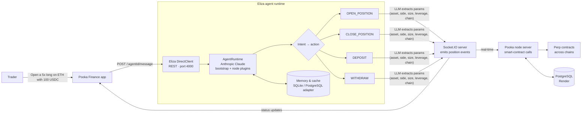

# PookaFinance Eliza Agent

The **PookaFinance Eliza Agent** is a custom AI-powered assistant for interacting with the PookaFinance cross-chain perpetuals trading platform. Built for the Chromium Hackathon, this agent enables users to open, close, deposit into, and withdraw from trading positions across chains using natural language commands.

The project consists of two key components:

* The **Eliza agent server** running on port `4000` (deployed on AWS)
* A **Node backend server** on port `5432` that interacts with on-chain smart contracts and is connected to a PostgreSQL database hosted on **Render**

WebSocket communication is enabled for real-time interaction and updates.

---

## Features

The Eliza agent supports four core actions, defined in the `src/actions/` directory:

* `openPosition.ts` – Initiates a cross-chain long or short position
* `closePosition.ts` – Closes an open position and realizes any PnL
* `depositPosition.ts` – Handles depositing collateral for trading
* `withdrawPosition.ts` – Allows users to withdraw available funds

These actions are triggered based on user intent, extracted from natural language inputs.

---

## Getting Started

### Prerequisites

* Node.js (version 22 or higher)
* pnpm (`npm install -g pnpm`)
* PostgreSQL database (configured via Render)
* WebSocket-compatible client (optional, for real-time interactions)

---

### 1. Clone the repository

```bash
git clone https://github.com/Devanshgoel-123/AgenticBackendPooka.git
```

---

### 2. Configure environment variables

Duplicate the `.env.example` file:

```bash
cp .env.example .env
```

Then update the `.env` file with your environment-specific values:

```env
ANTHROPIC_API_KEY=your-anthropic-key
SERVER_PORT=4000
NODE_SERVER_PORT=5432
POSTGRES_URL=
```

---

### 3. Start the Eliza agent

```bash
pnpm i && pnpm start
```
---

### Build and run 

Update `docker-compose.yaml` with your environment values:

```yaml
services:
  eliza:
    environment:
      - ANTHROPIC_API_KEY=your-key
      - SERVER_PORT=4000
      - NODE_SERVER_PORT=5432
```

Then start the container:

```bash
docker compose up
```

### Build and run for Apple Silicon (aarch64)

```bash
docker buildx build --platform linux/amd64 -t pooka-eliza-agent:v1 --load .
docker compose -f docker-compose-image.yaml up
```

---

## Architecture Overview



**Flow:** the app sends a chat message to the Eliza agent. The matching action uses Claude to pull structured trade parameters out of the message, then emits a Socket.IO event. The execution server picks up the event, calls the on-chain contracts, and streams status back to the app.


| Component       | Port | Description                          |
| --------------- | ---- | ------------------------------------ |
| Eliza Agent     | 4000 | Handles intent parsing and responses |
| Node Server     | 5432 | Manages smart contract interactions  |
| PostgreSQL      | —    | Hosted on Render                     |
| WebSocket Layer | —    | Real-time updates and status         |

---

## Deployment

* **Eliza Agent**: Deployed on AWS EC2
* **PostgreSQL**: Hosted on [Render](https://render.com)
* **WebSocket**: Enabled across services for real-time trade status

---

## License

This project is released under the MIT License.

---

